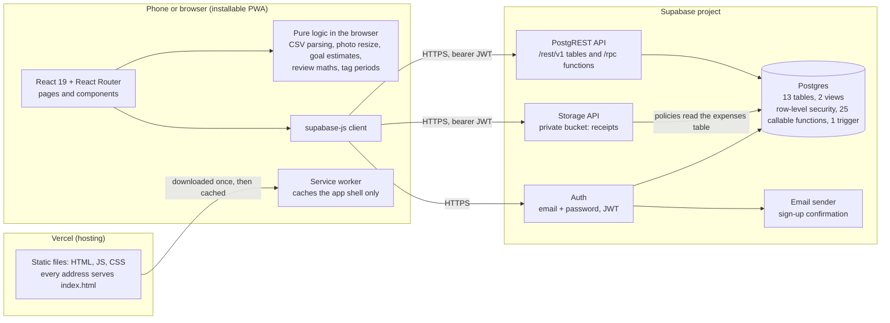
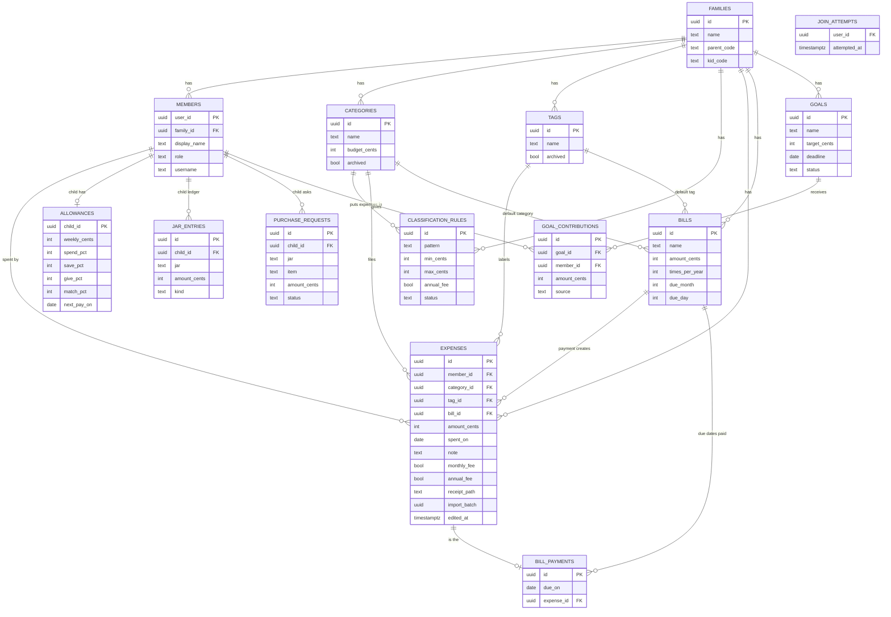
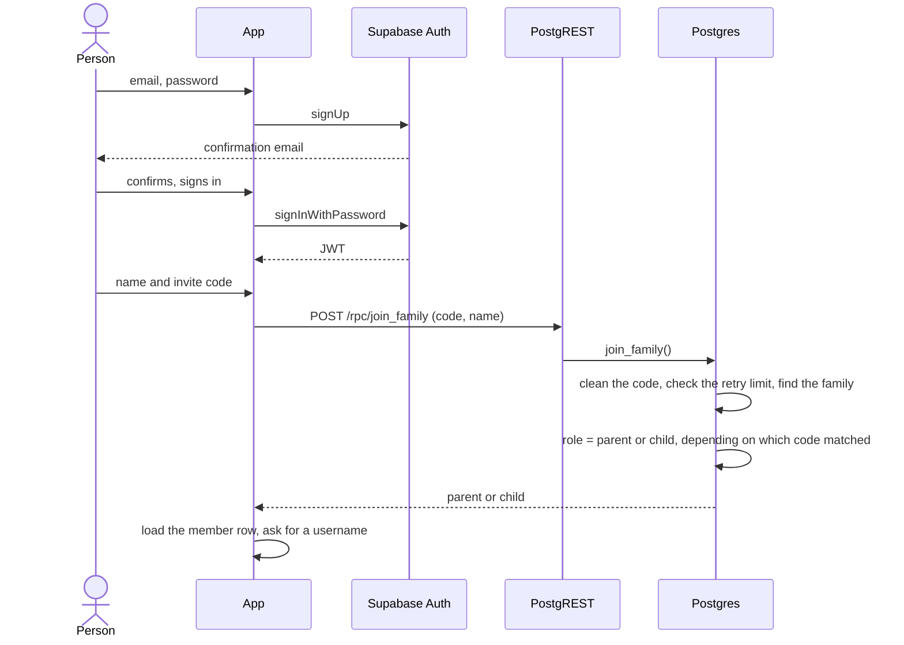
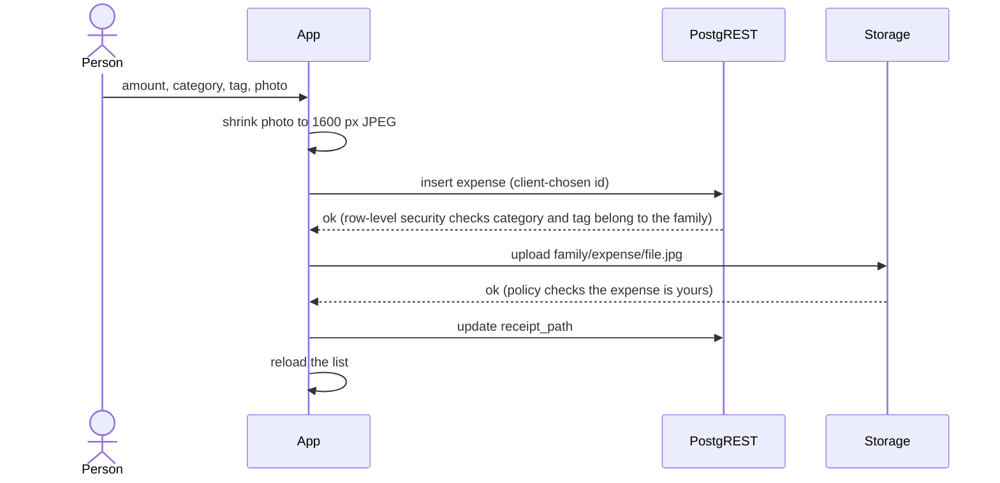
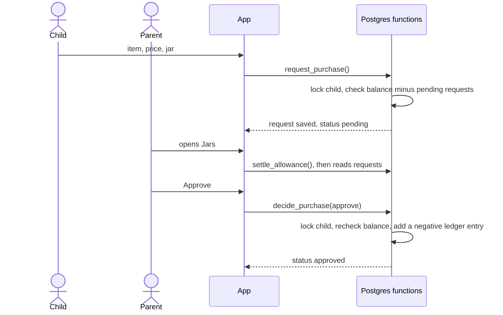
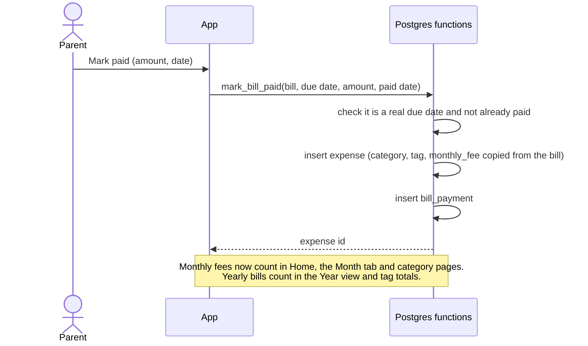

# FamilyFinance architecture

A shared family expense and savings tracker for parents and kids. This document describes what is built today:
how the pieces talk to each other, the API surface, the database, the security model and the use cases.

## 1. The big picture

There is **no custom backend server**. The app is a static single-page web app (an installable PWA) that talks directly
to a managed Supabase project. All business rules that involve money or permissions live **inside the database**
(row-level security and SQL functions), so the browser is never trusted to enforce them.

**How the parts communicate**

| From | To | How | Notes |
|---|---|---|---|
| Browser | Vercel | HTTPS GET of static files | Only the app itself. No data passes through Vercel. |
| Browser | Supabase Auth | HTTPS (`signUp`, `signInWithPassword`, `resetPasswordForEmail`, `updateUser`, `getSession`, `signOut`) | Returns a JWT that the client stores and refreshes automatically. |
| Browser | Supabase REST | HTTPS with the JWT. Reads and simple writes on tables, plus `POST /rpc/<function>` | Row-level security decides what each person sees and changes. |
| Browser | Supabase Storage | HTTPS: `upload`, `createSignedUrl`, `remove` | Receipt photos only. Links to a photo expire after 10 minutes. |
| Supabase | Email | SMTP, handled by Supabase | Sign-up confirmation. |

Things the app deliberately does **not** do today: no realtime subscriptions, no push or email notifications from the app,
no scheduled jobs, no serverless functions, no webhooks, no offline data. Every screen loads its data when opened and
reloads after the person changes something. The tab-bar counts refresh on navigation, when the app returns to the front, and right after
an action that changes them. Weekly allowances are paid lazily: the first person who opens the Jars screen after a
payday triggers `settle_allowance()`.

Build-time configuration is two public values, `VITE_SUPABASE_URL` and the publishable (anon) key. They are safe in the
browser because every table is protected by row-level security. The service-role key is never used.

## 2. The API

Supabase generates the REST API from the database. The app uses three kinds of call.

### 2.1 Table access (PostgREST)

| Table or view | Who reads | Who writes, and how |
|---|---|---|
| `families` | members of the family (invite codes hidden) | `create_family()` only |
| `members` | the whole family | `create_family()`, `join_family()`, `set_username()` |
| `categories` | the whole family | parents, directly |
| `expenses` | parents: all; children: their own | add: anyone, own rows. Edit and delete: children own, parents any. Bill payments are not editable directly. |
| `tags` | the whole family | any member can create; parents rename, archive, delete |
| `classification_rules` | the whole family (children get suggestions too) | parents only, directly; at most 300 per family |
| `bills` | parents only | parents, directly |
| `bill_payments` | parents only | `mark_bill_paid()`, `unmark_bill_paid()` only |
| `allowances`, `jar_entries`, `purchase_requests` | parents: all; children: their own | functions only (no direct writes) |
| `jar_balances` (view) | same as `jar_entries` | read-only |
| `goals`, `goal_contributions`, `goal_totals` (view) | the whole family | functions only |
| `join_attempts` | nobody | functions only (rate limit for invite codes) |

### 2.2 Database functions called as `POST /rest/v1/rpc/<name>` (25)

| Area | Function | What it does |
|---|---|---|
| Family and identity | `create_family`, `join_family` | Make a family (caller becomes a parent, default categories seeded). Join with a parent or kid code. |
| | `set_my_name`, `rename_family`, `rotate_invite_codes` | Change your own display name. A parent renames the family or replaces both invite codes (for example after one was shared by mistake). |
| | `family_codes` | Parents read the two invite codes. |
| | `set_username`, `email_for_username` | Choose a username. Look up the email for a username at sign-in (callable before signing in). |
| Kids' money | `set_allowance`, `add_money` | Parents set the weekly allowance, split and savings match. Parents add or remove money in a jar. |
| | `move_money` | Move money between jars. A child can only move from Spend into Save or Give. Savings moves earn the parents' match. |
| | `request_purchase`, `cancel_request`, `decide_purchase` | A child asks to buy something. A parent approves or declines. Approval spends from the jar. |
| | `settle_allowance` | Pays any allowance that is due, one payment per missed week, never twice. |
| | `child_stats` | Saving streak and badges for one child. |
| Family goals | `create_goal`, `contribute_cash`, `contribute_from_save`, `cancel_goal` | Parents create goals and add cash. A child gives from their Save jar. Cancelling refunds the jars. |
| Bills | `mark_bill_paid`, `unmark_bill_paid` | Paying a due date creates a normal expense and a payment record. Undo removes both. |
| Reports | `year_summary`, `tag_totals`, `tag_months` | Totals added up in the database, so a long history never hits the row limit of a plain query. Parents only. |

Not callable from the app: internal helpers (`lock_child`, `jar_balance`, `pending_total`, `assert_my_child`,
`goal_raised`, `check_goal_reached`, `normalize_code`, `family_has_data`), the policy helpers `my_family()` and
`is_parent()`, and the trigger `stamp_expense_edit`.

### 2.3 Auth and Storage

* Auth: `signUp`, `signInWithPassword`, `resetPasswordForEmail` (forgot password), `updateUser` (choose or change a password),
  `getSession`, `onAuthStateChange`, `signOut` (this device or all devices). Following the link in a reset email signs the person in
  briefly and the app shows a "Choose a new password" screen before anything else.
   Sign-in accepts an email or a username
  (the username is turned into an email by `email_for_username` first).
* Storage: bucket `receipts` (private, JPEG only, 3 MB limit). Files live at `<family id>/<expense id>/<random>.jpg`.

## 3. The database

One Postgres database shared by all families. Families are kept apart by row-level security, not by separate databases.

`join_attempts` is keyed by the sign-in account (not shown as a link above) and only the join function touches it.

Also: view `jar_balances` (sum of `jar_entries` per child and jar), view `goal_totals` (sum per goal), and `storage.objects`
(receipt photos, tied to an expense by the path).

**Design rules that matter**

* **Money is whole cents** in integer columns, in euros. Nothing is stored as a decimal.
* **Kids' money is an append-only ledger** (`jar_entries`). A balance is the sum of its entries. Nobody can write the ledger
  directly, so a balance can never be edited, only added to by a function that has already checked the rules.
* **Locking.** Functions that spend money lock the child's row first, so two taps at once cannot spend the same money twice.
* **Bill payments are expenses.** Marking a bill paid inserts a normal expense (flagged with `bill_id`) plus a `bill_payments`
  row. `monthly_fee` is a snapshot taken at payment time: payments of a monthly bill count as everyday spending, payments of
  yearly, half-yearly and quarterly bills are kept apart. Changing a bill later never rewrites past months.
* **One tag per expense** (`tag_id`), so tag totals plus "no tag" always add up to total spending.
* **Edits are stamped.** A trigger records who changed an expense's amount, category, note or date, and when. Clients cannot
  write that stamp.

## 4. Security model

There are two roles, **parent** and **child**, stored on the member row. Rules are enforced by Postgres, not by the screens.

| Mechanism | What it enforces |
|---|---|
| Row-level security on every table | Families are isolated. A child sees only their own expenses, ledger and requests. Bills are parents-only. |
| Column-level grants | Clients can write only the columns meant for them. Nobody can set `bill_id`, `monthly_fee`, `edited_by`, `edited_at`, `family_id` or `member_id` after creation. Invite codes cannot be read directly. |
| `SECURITY DEFINER` functions | All money movement, approvals, goals and bills go through functions that check the caller's role, the family, and balances before changing anything. |
| Invite codes | 12 characters (48 bits) from a secure generator, matched ignoring case, spaces and dashes. 30 well-formed wrong guesses per hour per account, checked before the code is looked up. |
| Storage policies | A receipt photo is readable and writable only by someone who may see its expense. The bucket is private and links expire. |
| Function permissions | Signed-out visitors can call exactly one function (`email_for_username`, needed to sign in with a username). Every other function, including the helpers used by the row rules, requires a signed-in account. Every `SECURITY DEFINER` function has a fixed `search_path`. Checked against Supabase's security advisor. |
| Public values only in the browser | The anon key is public by design. The service-role key is not used anywhere. |

## 5. Key flows

**Joining a family**

**Adding an expense with a receipt photo**

**A child asks to buy something, a parent approves**

**Paying a bill, and how it reaches the reports**

**Suggesting categories** (`lib/classify.ts`) runs in the browser. In order: (1) the family's own rules (`classification_rules`: text to look for, optional amount range, category, tag, annual-fee flag; the most specific rule wins; `off` and `dismissed` rules are skipped); (2) the family's own latest 1,000 categorised notes, turned into a word index and scored; (3) a built-in European shop list matched against the family's category names. It returns a category, a confidence (high = pre-selected, medium = offered), a one-line reason and, for a rule, its tag and annual-fee flag. It is used when adding an expense and in the bank import. A parent who changes a suggestion can choose Remember (one rule per shop), and Plan → Rules lists patterns the family keeps repeating so a parent can turn them into rules. Nothing is sent to a third party.

**CSV bank import** is entirely client-side until the last step: the file is read and parsed in the browser (never
uploaded), columns, dates, signs and categories are suggested locally, duplicates are checked against existing expenses,
and then the chosen rows are inserted in batches of 200 with one `import_batch` id so the whole import can be undone.
Each row can be marked as an **annual fee** (ticked automatically when the description says "annual", "yearly" or "jaarlijks"): the row is sent with
`annual_fee = true` and is then kept apart from everyday spending exactly like a yearly bill payment. The same checkbox is on the expense form.

## 6. The web app

* React 19, React Router, Vite, TypeScript, `supabase-js`, `papaparse` (CSV). No global state library: each screen loads
  its data with small hooks, and `AuthProvider` holds the signed-in person.
* Routes: `/` Home, `/jars`, `/goals`, `/review` (parents, and the category detail for everyone), `/plan` (parents), `/settings` (profile and family settings, for everyone; opened from the name at the top left).
* Business logic that does not need trust lives in plain, unit-tested modules: CSV parsing and category suggestions
  (`csv.ts`), photo resizing, goal estimates, the month comparison, tag periods and totals, category previews.
* Installable PWA (service worker caches the app shell). Data always needs a connection.
* Hosting: Vercel serves the static build. Updates deploy on every push to `main`.

## 7. Use cases

| # | Use case | Who | Screen | Calls |
|---|---|---|---|---|
| 1 | Create an account, sign in with email or username | everyone | Login | Auth, `email_for_username`, `set_username` |
| 2 | Start a family and invite parents or kids with a code; copy a ready-made invitation; replace the codes | parent | Setup, Settings → Family | `create_family`, `family_codes`, `rotate_invite_codes` |
| 3 | Join a family with a code | everyone | Setup | `join_family` |
| 3c | See a "Get started" checklist on Home (hideable, worked out from the family's own data) | everyone | Home | `expenses`, `members`, `allowances`, `bills`, `categories` (counts only) |
| 3d | See counts on the tab bar: requests waiting, bills due, answers not yet seen | everyone | Tab bar | `purchase_requests`, `bills`, `bill_payments` |
| 3a | Reset a forgotten password by email, or change it when signed in; sign out of all devices | everyone | Login, Settings → My profile | Auth |
| 3b | See and edit your own profile (name, username); see who is in the family; rename the family | everyone (rename: parents) | Settings | `set_my_name`, `set_username`, `rename_family`, `members` |
| 4 | Log, edit, delete an expense (category, note, date) | everyone, own rows (parents: any) | Home | `expenses` |
| 5 | Attach a receipt photo | everyone | expense form | Storage, `expenses.receipt_path` |
| 6 | Tag expenses; tag many at once; filter by tag | everyone (filter and bulk on Home) | expense form, Home | `tags`, `expenses` |
| 7 | Set monthly budgets per category; add, rename, archive categories | parent | Plan → Budgets | `categories` |
| 8 | See spending against budgets by month, with warnings from 80% | parent | Home | `expenses`, `categories` |
| 9 | Hover a category for its 3 latest, click for all its expenses | everyone | Home → Review | `expenses` |
| 10 | See where a month's money went (pie or bars; flow on wide screens, opening up the tags of a picked category), compared with the month before, with each category's budget hint; browse earlier months | parent | Review → Month | `expenses`, `categories` |
| 11 | See the year by month and by category (pie or bars), how the mix changed, and goal progress | parent | Review → Year | `year_summary`, `goals` |
| 12 | Add up spending by tag for a month, a year or all time | parent | Review → Tags | `tag_totals`, `tag_months` |
| 13 | Track yearly, half-yearly, quarterly and monthly bills; mark paid; see which are coming up (highlighted by urgency); get reminders | parent | Plan → Bills, Home | `bills`, `mark_bill_paid`, `unmark_bill_paid` |
| 14 | Import a bank CSV with suggested categories; undo an import; mark rows as annual fees | parent | Plan → Import | `expenses` (batched) |
| 14c | Tidy up Other: move past expenses out of Other with a preview, then undo | parent | Plan → Rules | `expenses` (grouped updates) |
| 14b | Get a category suggested (with the reason) while typing an expense and in the bank import | everyone (import: parent) | expense form, Plan → Import | `expenses` (history) |
| 14a | Mark any expense as an annual fee so it is not counted as monthly spending (and turn it off again) | everyone, own rows (parents: any) | expense form, Plan → Import | `expenses.annual_fee` |
| 15 | Give a child a weekly allowance split into Spend, Save, Give, with an optional savings match | parent | Jars | `set_allowance`, `settle_allowance` |
| 16 | Add or remove a child's money; move money between jars | parent, child (limited) | Jars | `add_money`, `move_money` |
| 17 | A child asks to buy something; a parent approves or declines | child, parent | Jars | `request_purchase`, `cancel_request`, `decide_purchase` |
| 18 | Save towards a shared family goal, see time-to-goal, cancel with refunds | parent, child | Goals | `create_goal`, `contribute_*`, `cancel_goal` |
| 19 | Earn badges and a weekly saving streak | child | Jars | `child_stats` |

## 8. Operations

* **Schema:** `supabase/schema.sql` builds a new project in one go. An existing project upgrades by running
  `supabase/migrations/002` to `015` in order (each is safe to run once).
* **Tests:** 394 database checks (`supabase/tests`, run on a scratch Postgres with a stand-in for Supabase's auth and
  storage), 256 unit tests (`app/src/lib`), and about 630 browser checks against a stubbed backend (`app/e2e`).
* **Secrets:** none are stored in the repository. The committed `.env` holds only the public URL and publishable key.

## 9. Known limits

* Password reset needs the app's address to be allowed under Authentication → URL Configuration in Supabase, and uses Supabase's
  built-in email sender, which has a low hourly limit.
* Anyone can turn a username into that person's email through `email_for_username` (the price of signing in with a username). Fine for a private family app, worth revisiting before opening it to strangers.
* Request and response only: nothing updates live on another person's screen until they reload or act.
* No notifications. Due bills and purchase requests are only visible when someone opens the app.
* Reads of plain lists are capped by Supabase at about 1,000 rows per request (the monthly lists and the Month tab).
  The year and tag reports are not affected because the database adds them up.
* One tag per expense. One family per account. Euro only. English only.
* Monthly fees are recorded when a parent taps Mark paid, not automatically.
* Receipt photos are stored but not read automatically.
* A photo can be left behind in storage if an expense is removed some way other than through the app.
