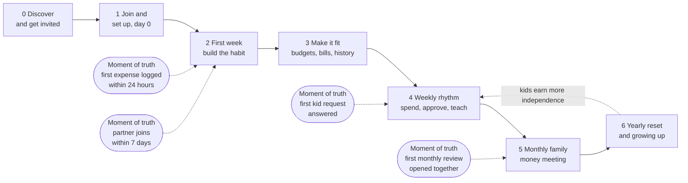
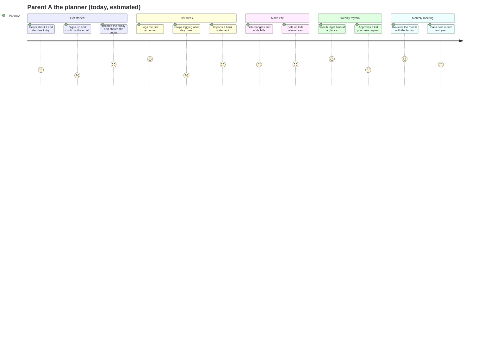
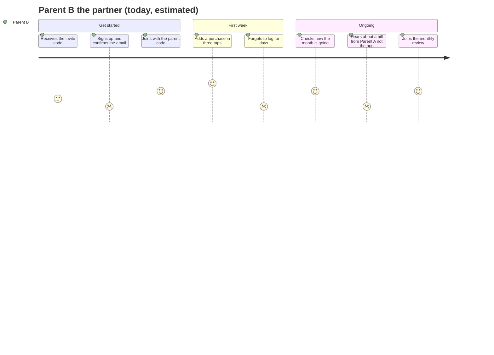
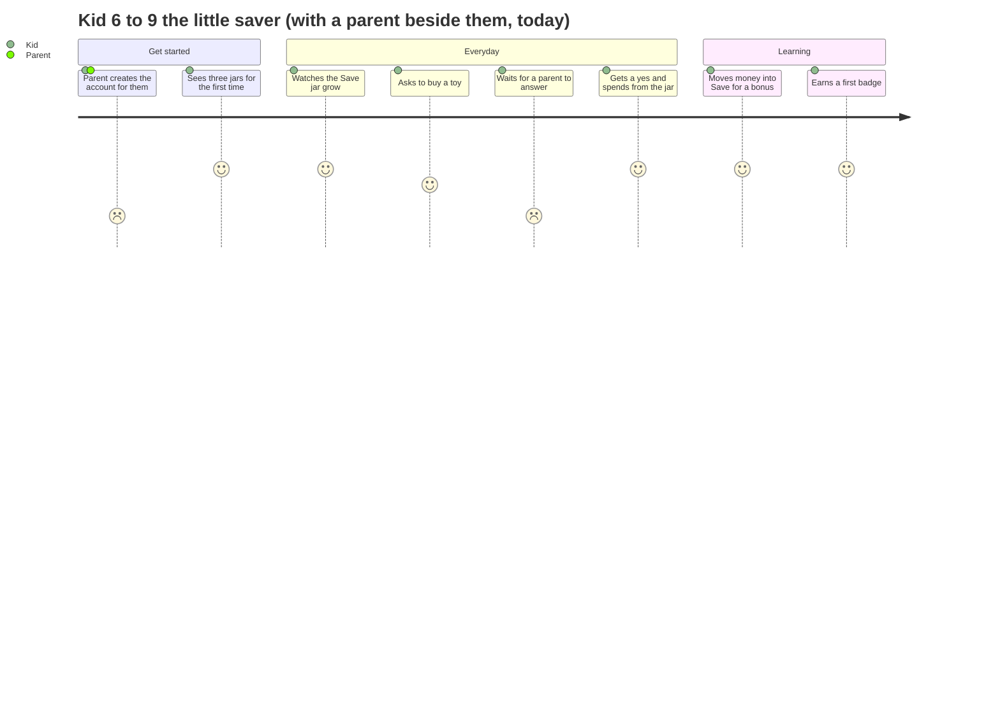
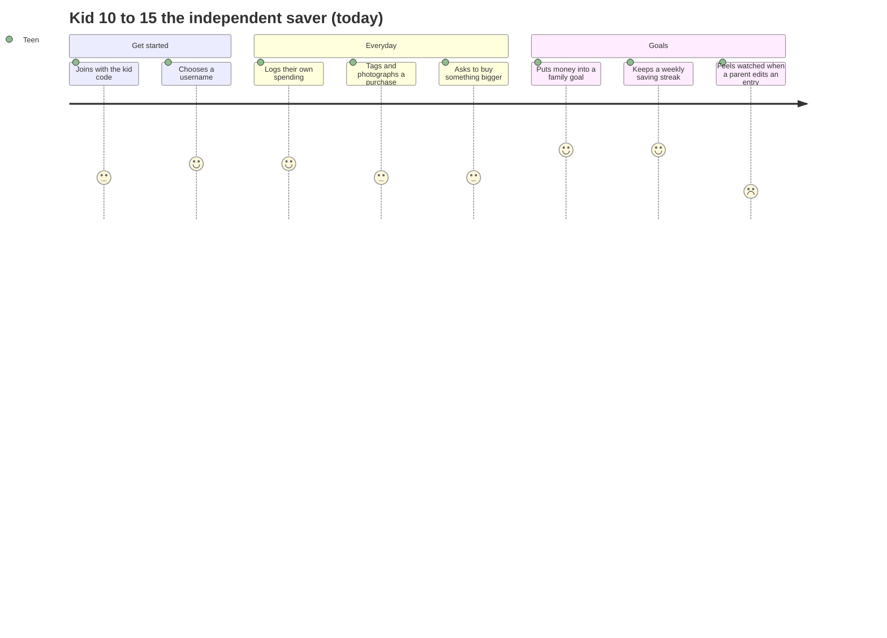

# Target user journey

How a family is meant to move from "we should track our money" to "this is how our family handles money".
This is a **target** journey built from the product as it exists today, not from user research. Every feeling, score and
risk is a hypothesis to check with the first real families. Scores run from 1 (frustrated) to 5 (delighted) and describe
the experience **today**, so the low points show where to work next.

## 1. Who it is for

The product serves a family with two kinds of users who need different things from the same data.

| Persona | Who | What they want | What worries them | Device |
|---|---|---|---|---|
| **Parent A: the planner** | 25 to 40, runs the household money, starts the family in the app | Control spending without a spreadsheet. Teach the kids about money. Know where the money goes and what is coming. | Another chore. A partner who never logs anything. Kids seeing things they should not. | Phone first, sometimes a laptop |
| **Parent B: the partner** | Joins with a parent code | Add a purchase in seconds, see how the month is going, not be nagged. | Being blamed for spending. Complicated screens. | Phone |
| **Kid, 6 to 9: the little saver** | Needs a parent beside them | Simple, visual money. Know how much is mine. Ask for things and get an answer. | Reading, typing, waiting. | Parent's or own tablet or phone |
| **Kid, 10 to 15: the independent saver** | Has their own device | Own money, own goals, a bit of independence and recognition. | Feeling watched. Boring screens. | Own phone |

**The family's two goals** (from the brief): control spending, and teach kids about money. The journey is successful when
both happen without the app becoming a burden.

## 2. The lifecycle at a glance

## 3. Stage by stage

For each stage: what the person is trying to do, the steps and the screens they use, how they probably feel, the friction
that exists today, and how we will know it worked.

### Stage 0. Discover and get invited

* **Goal.** Understand what this is and decide to try it. For everyone except the first parent, simply accept an invite.
* **Steps.** A parent hears about it or builds it. They share the web address and, later, an invite code in a chat.
* **Feeling.** Curious but wary ("not another app"). The invited partner and kids feel little at this point.
* **Friction today.** There is no landing page or short explanation. The invite is a bare code you must send yourself.
* **Success.** The invited person opens the link and starts signing up.

### Stage 1. Join and set up (day 0)

* **Goal.** Get from the link to a working family in about five minutes.
* **Steps and screens.**
  1. Login: create an account with email and password.
  2. Confirm the email (a message arrives, the person taps the link, then signs in).
  3. Setup: **Parent A** creates the family. **Everyone else** types their name and the invite code.
  4. Choose a username (so they can sign in without typing an email).
  5. Parent A opens Plan → Family to copy the **parent code** and **kid code**.
* **Feeling.** Hopeful, then impatient at the email step. Anxious about the code ("did I type it right?").
* **Friction today.**
  * Email confirmation breaks the flow, and the built-in email sender is slow and rate-limited. A confirmation that never arrives ends the journey.
  * **Kids need an email address to sign up.** A six-year-old has none, so a parent has to set up the child's account with an address they control.
  * Invite codes were hard to enter exactly. This is now forgiving (capitals, spaces and dashes are fine, and someone who created an empty family by mistake can still join), but the person still has to send and receive a 12-character code.
  * Two forms on one screen ("join" and "start a new family") invite a wrong tap.
* **Success.** Within one sitting, Parent A and at least one other person are in the family.

### Stage 2. The first week: build the logging habit

* **Goal.** Make recording an expense so quick that it becomes automatic.
* **Steps and screens.** Home → "+" → amount, tap a category, save (three taps). Optionally add a note, a tag such as "Vietnam trip", or a receipt photo. Look at Home to see the month so far and the budget bars.
* **Feeling.** Motivated for two or three days, then the **big drop-off risk**: forgetting, or feeling it is too much work.
* **Friction today.** Everything is manual. There are no reminders to log. Nothing in the app pulls the person back.
* **Success.** At least three expenses in the first week, from at least two people. This is the single best predictor that the family keeps going.
* **Help available.** CSV import (Plan → Import) lets a parent load a month of bank history in minutes, which also makes the first review worth opening.

### Stage 3. Make it fit: budgets, bills and history

* **Goal.** Turn raw logging into a plan the family believes in.
* **Steps and screens.**
  * Plan → Budgets: adjust the monthly amount for each category (eight are provided), add or rename categories.
  * Plan → Bills: add insurance, subscriptions and other recurring costs with their due dates. Monthly fees count as normal spending, yearly and quarterly bills are kept apart so one big payment does not wreck a month.
  * Plan → Import: bring in past bank statements, review suggested categories, undo if wrong.
  * Jars: set each child's weekly allowance and how it splits into Spend, Save and Give.
* **Feeling.** Productive but slightly overwhelmed. Satisfied when the budget bars show real numbers.
* **Friction today.** Nothing guides the order of these steps. A new parent lands on an empty Home with no checklist.
* **Success.** Budgets set, at least one bill added, and an allowance configured, within two weeks.

### Stage 4. The weekly rhythm: spend, approve, teach

* **Goal.** Keep control as life happens, and let kids practise.
* **Steps and screens.**

| Who | What they do | Screen |
|---|---|---|
| Parents | Log purchases, glance at budget bars (amber from 80%, red when over), pay or schedule due bills (a "Bills coming up" card appears), fix mistakes by tapping an expense | Home, Plan → Bills |
| Parent | **Approve or decline a child's purchase request**, add birthday money, check streaks | Jars |
| Kid 6 to 9 | See three big jars, ask a parent to approve a purchase, move money from Spend into Save or Give | Jars |
| Kid 10 to 15 | Log own spending, add to a family goal from their Save jar, earn badges and a weekly saving streak | Home, Jars, Goals |

* **Feeling.** Parents: in control, occasionally nagged. Kids: proud when the Save jar grows, impatient waiting for approval.
* **Friction today.**
  * No notifications. A child's request sits until a parent happens to open Jars, which feels slow to the child and teaches the wrong lesson about asking.
  * Bills are only noticed when someone opens the app.
  * Allowances are paid when someone opens the Jars screen, which is invisible to the family but means the first visit after payday does a catch-up.
* **Success.** Requests answered the same day. Weekly active members is the whole family.

### Stage 5. The monthly family money meeting

* **Goal.** Turn the numbers into a conversation that is positive and shared.
* **Steps and screens.**
  1. Review → This month: compare with last month, starting with wins ("we spent 42% less on Eating out"), then comfortably-within-budget categories, then "worth a look".
  2. Tap a category on Home (or hover for its three latest) to see exactly what is behind a number.
  3. Review → Tags: see what a trip or a project cost in total.
  4. Goals: see progress to a shared goal, the estimated date, and what saving a little more would change.
  5. The review ends with a conversation prompt for the family.
* **Feeling.** The intended high point: proud, informed, not blamed.
* **Friction today.** Nothing starts the meeting. There is no monthly summary sent to the family, and the screen is built for one phone, not for a table of people.
* **Success.** The Review page is opened once a month, and the family changes something (a budget, a habit or a goal) as a result.

### Stage 6. The yearly reset and growing up

* **Goal.** Plan the year and let kids earn more independence.
* **Steps and screens.** Review → Year (spending by month, by category, with yearly bills shown separately). Plan → Bills for renewals. Plan → Budgets for next year. For kids: the same app, but with bigger goals, their own tags, and, as they grow, more of their own money.
* **Feeling.** Reflective, satisfied. A reason to stay.
* **Friction today.** Budgets do not roll or suggest themselves from history. Receipts are stored but not read.
* **Success.** The family is still using the app a year in, and the kids use it themselves.

## 4. The experience over time, per persona

Scores describe the experience today (estimated). A dip marks friction.

## 5. How the kids' journey grows with them

| Age | The skill | What the app offers | What a parent does |
|---|---|---|---|
| 6 to 9 | Money has a limit; saving, spending and sharing are different things | Three jars, ask to buy, badges | Sits with them, answers requests, explains the answer |
| 10 to 12 | Waiting for something bigger; the idea of interest | Savings match, family goals with an estimated date, streaks | Sets a match, talks about the goal |
| 13 to 15 | Tracking, choosing, trade-offs | Own expense logging, categories, tags, receipt photos | Reviews together, edits only to fix mistakes |
| 16 and up | Running a small budget alone | Same tools, higher allowance and own categories | Steps back |

## 6. Moments of truth and drop-off risks

| Moment | Why it decides the journey | Today | Risk |
|---|---|---|---|
| First account created and confirmed | No account, no journey | Email and password, then a confirmation email | High: the confirmation email can be slow or missing |
| First expense in 24 hours | Proves it is quick | Three taps | Low |
| Partner joins in a week | A one-person tracker stops working | Parent code, forgiving matching | Medium: the person must send and receive the code |
| Logging continues after day three | The habit | Manual only | **High: no reminders** |
| First kid request answered | Makes the teaching real | Parent must open Jars | **High: no notifications** |
| First monthly review opened together | Delivers the payoff | Review page, family-meeting prompt | Medium: nothing triggers it |
| Parent edits a child's entry | Trust | Marked "edited by" | Medium: a teen may feel watched |

## 7. What success looks like

| Stage | Measure | Healthy target (to confirm) |
|---|---|---|
| 1 Set up | Family created and at least two members in it | Within one day |
| 2 First week | Expenses logged | At least 3, from at least 2 people |
| 3 Make it fit | Budgets set, a bill added, an allowance set | Within two weeks |
| 4 Weekly | Weekly active family members | Everyone who joined |
| 4 Weekly | Time to answer a child's request | Same day |
| 5 Monthly | Review opened | Once a month |
| 6 Yearly | Family still active after a year; kids using it themselves | Yes |
| Outcomes | Categories within budget; goals reached; kids' saving streaks | Improving month on month |

## 8. Gaps and opportunities, in order of impact on the journey

| Priority | Opportunity | Stage it helps | Today |
|---|---|---|---|
| 1 | **Reminders and notifications** (email first): a child's request is waiting, a bill is due, a gentle nudge when nothing was logged for several days | 2, 4 | Not built |
| 2 | **First-run checklist** on an empty Home: add an expense, set budgets, invite your partner, set an allowance | 1, 2, 3 | Not built |
| 3 | **One-tap invite sharing**: copies the code with a short message for chat apps | 0, 1 | Codes are shown only |
| 4 | **Parent-assisted kid sign-up**: a guided way to create a child's account on their device | 1 | Needs the child's own email |
| 5 | **Monthly summary** sent to the family and a "family meeting" layout for a shared screen | 5 | Review page only |
| 6 | **Automatic monthly fees** recorded on their due day | 3, 4 | Recorded when a parent taps Mark paid |
| 7 | **Receipt reading** (amount and shop filled from a photo) | 2 | Photos are stored, not read |
| 8 | **Install prompt** to add the app to the home screen | 1, 2 | Installable, but not suggested |
| 9 | **Vietnamese and other languages** | 1 to 6 | English only |

## 9. Links

* How it is built: [ARCHITECTURE.md](ARCHITECTURE.md)
* The screens named above are all in the running app: Home, Jars, Goals, Review and Plan.
